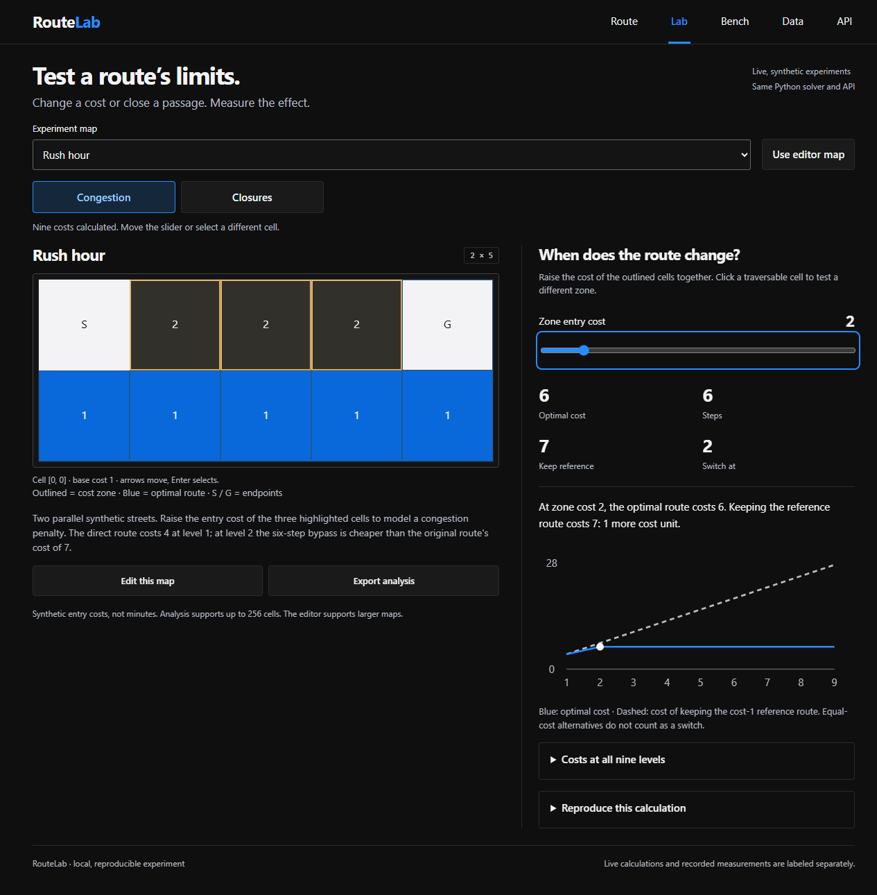
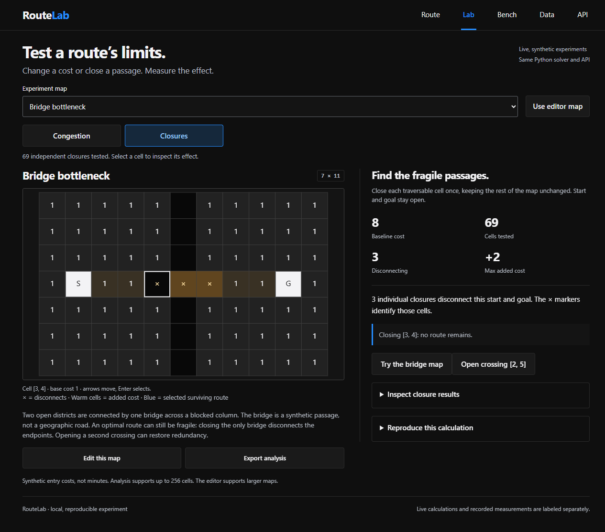
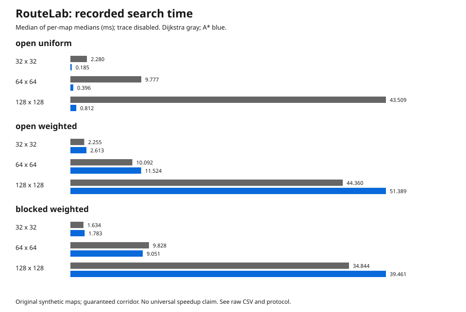

[Annotated application walkthrough](docs/presentation/GALLERY.md) · [Static cover](docs/presentation/cover.png)

# RouteLab

Find when congestion makes an alternative route cheaper, identify single-cell closures that disconnect a map, and measure the effect of opening another passage. RouteLab uses its own Dijkstra and A* implementations through a Python service, map editor, experiment Lab, JSON API, and CLI.



[Actual narrow-pane Lab](docs/images/lab-in-app-319.png) · [Map editor](docs/images/app-desktop.png) · [API explorer](docs/images/api-desktop.png)

Use it to understand the difference between the fewest steps and the lowest travel cost, test your own synthetic scenarios, and inspect measured algorithm behavior. The grid models abstract traversal costs. It does not represent a surveyed campus or provide geographic navigation.

## Try two measured experiments

The first screen has **Find the congestion threshold** and **Test a bridge closure** actions. They open the matching Lab experiment and leave your editor map intact. Failed experiment loading has a retry action.

JSON imports validate before committing. Changing the map, editing the JSON draft or starting a newer import cancels the older validation result, including stale errors. Edits are never replaced by a late import response.


Open the **Lab** tab after starting the local app.

1. **Rush hour:** move the zone-cost slider from 1 to 2. The original four-step route costs 4 at level 1. At level 2, keeping that route costs 7; the six-step bypass costs 6. The first strict loss of optimality occurs at level 2. Equal-cost alternatives do not count as a switch.
2. **Bridge bottleneck:** inspect the closure map. Closing any of three specific cells disconnects start and goal. Click **Open crossing [2, 5]**. The service tests the modified map and reports zero disconnecting single-cell closures, compared with three before the edit. This does not establish resilience to simultaneous failures.

Use **Edit this map**, change a passage in the editor, then choose **Use editor map** in Lab to measure your own edit. **Export analysis** saves the actual map, experiment settings and response. Both experiments also work through Python and the API.



The new scenario set includes City blocks, Rush hour, Roadworks, Main road vs bypass, Bridge bottleneck and Disconnected district, alongside the four original examples. Each includes an explanation; solve-ready JSON files live in `examples/`. See [experiment definitions and limits](docs/EXPERIMENTS.md).

## Start locally

Python 3.12 or later; runtime dependencies: standard library only.

```sh
python -m venv .venv
# Windows PowerShell: .\.venv\Scripts\Activate.ps1
# macOS/Linux: source .venv/bin/activate
python -m pip install -e .
python -m route_lab demo --results results --port 8767
```

Open `http://127.0.0.1:8767`. Keep the supplied `results/` directory for the recorded benchmark. Route solving accepts your current map and does not require a recorded result. The local server binds to loopback. Public deployment needs a separate server and resource-control review.

## A cheaper route can take more steps

```text
Start  9  9  9  Goal
  1    1  1  1    1
```

All unspecified walkable cells have entry cost 1. The direct route takes four steps and costs 28. The detour takes six steps and costs 6.

```sh
python -m route_lab solve --input examples/weighted-detour.json --algorithm astar
python -m route_lab solve --input examples/weighted-detour.json --compare
python -m route_lab solve --input examples/weighted-detour.json --output route.json --path-csv route.csv
```

`--output` saves the actual result. `--path-csv` exports the returned coordinates and cumulative cost; the first row has entry cost 0. An unreachable destination produces `reachable: false`, null cost, and an empty path rather than a fabricated route.

## Grid and search contract

| Property | Meaning |
|---|---|
| Shape | Rectangular grid, 1..128 rows and columns |
| Values | Integer 0 is a wall; integers 1..9 are entry costs |
| Coordinates | Zero-based `[row, column]` |
| Movement | Four orthogonal neighbors |
| Route cost | Sum of entered cells, excluding the start |
| Algorithms | Own heap-based Dijkstra and A* implementations |
| A* heuristic | Manhattan distance times the minimum positive cell cost |
| Trace limit | 0..2048 recorded expansions; the search still completes |

Entering a cost-9 cell costs 9 and returning to a cost-1 cell costs 1. The weighted graph therefore has directed edge costs. Both algorithms return an optimal cost under this model; equal-cost paths may differ.

The solver orders ties by `(f, h, insertion serial)` and visits neighbors up, right, down, left. `expanded` counts accepted nonstale node pops, including the goal. `heap_peak` counts queue entries, including stale entries. The trace records explored nodes, not full frontier snapshots. See [algorithm details](docs/ALGORITHMS.md).

## Actual recorded benchmark

The supplied run contains **45 scenario configurations (33 unique maps), 90 algorithm summaries, and 450 timed runs**. The open uniform map repeats across five seed labels at each size; those runs measure timing repetition rather than extra map diversity. Each algorithm has one warmup and five measured repetitions per map. Three sizes, three map families, and five seeds cover uniform, weighted, and blocked weighted grids. A reserved corridor guarantees a route in these benchmark maps; separate correctness tests cover unreachable destinations.



The chart shows medians across per-map timing medians. Inspect the [per-seed summary](results/benchmark.csv), [all raw timings](results/benchmark-raw.csv), and [machine/protocol metadata](results/benchmark.json). Timings include search and path reconstruction; they exclude validation, JSON serialization, and browser rendering. Trace recording is disabled during the benchmark. A single interactive timing cannot establish a performance ranking.

```sh
python -m route_lab benchmark --output results
```

This command regenerates the measurements on your machine. It overwrites benchmark artifacts in the selected output directory; choose another directory to retain the supplied run. A* may spend time computing its heuristic even when it expands fewer nodes. We make no universal speedup claim.

## API and reuse

The app includes an API view for real same-origin requests. Use `POST /api/solve` for one algorithm, `POST /api/compare` for both, and `GET /api/presets` for original synthetic maps. See [API examples and validation rules](docs/API.md).

```python
from route_lab.service import compare, solve

scenario = {
    "grid": [[1, 9, 9, 9, 1], [1, 1, 1, 1, 1]],
    "start": [0, 0],
    "goal": [0, 4],
}
result = solve({**scenario, "algorithm": "astar", "trace_limit": 0})
assert result["cost"] == 6
assert compare(scenario)["costs_agree"]
```

## Verify and contribute

```sh
python -m pip install -e ".[dev]"
python -m pytest -q
python scripts/verify_results.py
python -m build
```

Core checks independently validate paths and compare both solvers with a Bellman-Ford oracle: 648 exhaustive 2x2 grid/endpoint combinations and 60 seeded random maps, each with both algorithms. Additional checks cover directed entry costs, unreachable goals, strict input validation, deterministic traces, export reconciliation, and recorded timing artifacts. See [verification notes](docs/VERIFICATION.md) and [contribution guidance](CONTRIBUTING.md).

## Scope and sources

This project implements established algorithms. It demonstrates modeling, correctness, API reuse, and repeatable measurement. It does not introduce a new shortest-path algorithm. The maps are original synthetic fixtures; costs have abstract units. Real walking time, accessibility, changing crowds, stairs, and road regulations require additional data and a different model.

Source references and asset attribution appear in [SOURCES.md](docs/SOURCES.md). Code and original synthetic fixtures use the [MIT license](LICENSE). Reliable Text Lab, DemandForecast, and UnknownVision are separate projects with different datasets and questions.

## Browser regression checks

Start the local app on port8767. Optional UI checks use Node.js and Playwright; these are development tools, not Python runtime dependencies.

```sh
npm install --no-save --no-package-lock playwright@1.62.1
npx playwright install chromium
node tests/browser-ui.cjs
node tests/browser-lab.cjs
```

The check covers the actual319px application pane as well as mobile, tablet and desktop layouts. See [responsive correction and verification](docs/UI_FIX_2026-10-20.md) for the64 recorded browser assertions and remaining limits.

The resilience update passed 115 Python tests and 119 browser assertions (68 editor, 51 Lab), with an independent code review. The supplied benchmark retains its exact historical source snapshot; its service module predates the Lab. See [release evidence](docs/LAB_VERIFICATION_2026-10-20.md).

Current correction record: [audit fixes and fresh checks](docs/AUDIT_FIXES_2026-10-20.md). This separates the latest focused checks from earlier release evidence.
