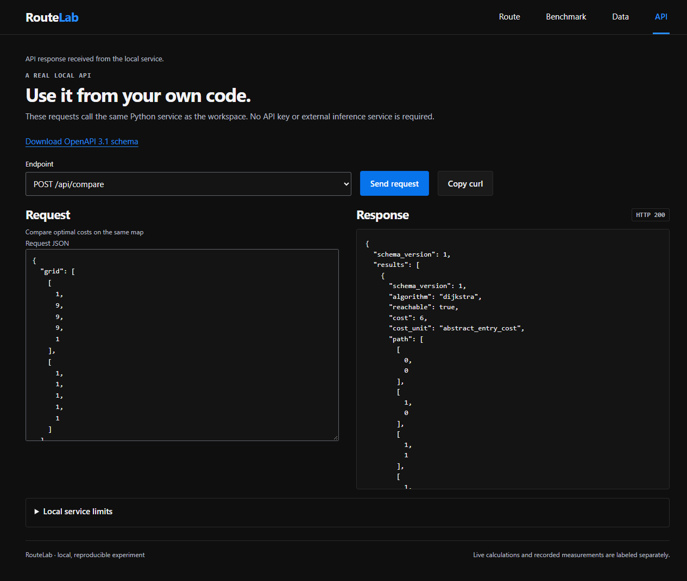

# RouteLab API

Default local origin: `http://127.0.0.1:8767`. Requests use `Content-Type: application/json`. Coordinates use zero-based row/column order. Solve/compare accept grids up to 128 by 128; analysis accepts at most 256 total cells, including walls. The local HTTP layer validates bodies before starting search. Consult the app's OpenAPI download for the exact server endpoint inventory.

## Solve

```sh
curl -X POST http://127.0.0.1:8767/api/solve -H "Content-Type: application/json" -d '{"grid":[[1,9,9,9,1],[1,1,1,1,1]],"start":[0,0],"goal":[0,4],"algorithm":"astar","trace_limit":512}'
```

PowerShell users can avoid shell quoting differences:

```powershell
$body = @{grid=@(@(1,9,9,9,1),@(1,1,1,1,1)); start=@(0,0); goal=@(0,4); algorithm='astar'; trace_limit=512} | ConvertTo-Json -Depth 10
Invoke-RestMethod http://127.0.0.1:8767/api/solve -Method Post -ContentType application/json -Body $body
```

Required fields: `grid`, `start`, `goal`. Optional fields: `algorithm`, default `astar`, one of `astar` and `dijkstra`; `trace_limit`, default 512, integer 0..2048. Unknown fields fail validation. Cell values must be integers 0..9; booleans, floats, strings, nulls, negative values, and nonfinite numbers fail validation.

The response contains `schema_version`, `algorithm`, `reachable`, `cost`, `cost_unit`, `path`, `steps`, `expanded`, `heap_peak`, `runtime_ms`, `trace`, `trace_truncated`, and `heuristic`. `cost_unit` is `abstract_entry_cost`. Trace entries contain `node`, `g`, `h`, and `f`. `runtime_ms` measures the actual search, including path reconstruction and any requested trace capture. It excludes HTTP and rendering.

The example's route costs 6 over six steps. The destination contributes its entry cost; the start contributes zero. An unreachable result returns HTTP 200 with null cost, null steps, and an empty path. Start equals goal returns the singleton path, zero cost, and zero steps.

## Compare

`POST /api/compare` accepts `grid`, `start`, `goal`, and optional `trace_limit`. It returns `{ "schema_version": 1, "results": [dijkstra_result, astar_result], "costs_agree": true }`. Do not send `algorithm` to this endpoint. A cost disagreement raises an internal error rather than silently approving inconsistent output.

## Presets

`GET /api/presets` returns `schema_version`, `kind: original_synthetic_maps`, and `scenarios`. Each scenario has `id`, `name`, `grid`, `start`, and `goal`. Extract only `grid`, `start`, and `goal` when submitting a preset to the solver; descriptive metadata is not part of a solve request.

## Errors

The HTTP layer returns a flat `{ "error": "Readable message", "code": "validation_error", "field": "grid[0][1]" }` shape for validation errors where a field is available. Exact HTTP media/body limits belong to the server's OpenAPI contract. Client code should show the message and preserve the current scenario for correction.

Python callers receive `route_lab.core.ValidationError`, a `ValueError` subclass with `.field`. The Python service does not parse raw JSON. HTTP and CLI callers must reject duplicate JSON object keys and `NaN`/`Infinity` before service validation.

## Local data

The solver needs no external service, accounts, or database. Editing a scenario invalidates its old displayed result. Uploaded scenario JSON must use the same validation rules as the editor. Do not treat exported abstract costs as real travel times.

## Inspect requests in the application



The [saved OpenAPI contract](openapi.json) describes request and operation-response fields. The running server also exposes `/openapi.json`.

## Congestion threshold

`POST /api/threshold` requires exactly `grid`, `start`, `goal`, `cells`. The zone contains 1..32 unique traversable coordinates excluding start and goal. Neither `algorithm` nor `trace_limit` is accepted. The server changes the zone to each integer cost 1..9 and reruns A* with trace recording disabled.

```python
from route_lab.service import threshold

result = threshold({
    "grid": [[1,1,1,1,1], [1,1,1,1,1]],
    "start": [0,0], "goal": [0,4],
    "cells": [[0,1], [0,2], [0,3]],
})
assert result["first_switch_cost"] == 2
```

The response contains `schema_version`, `cost_unit`, `cells`, `reference_path`, `first_switch_cost`, and nine `levels`. Each level contains `entry_cost`, `reachable`, `cost`, `steps`, `path`, `reference_cost`, `reference_optimal`. The reference is the deterministic route found at zone cost 1. The first switch is the first level where that reference costs strictly more than the optimum; ties do not count. No switch in 1..9 gives null. If disconnected, paths are empty, costs null, `reference_optimal` false.

## Independent closures

`POST /api/closures` requires exactly `grid`, `start`, `goal`. It solves the baseline, then independently closes each traversable non-endpoint cell and solves again. It restores the original map for each case. The response contains `baseline`, `tested_count`, `critical_count`, `critical_cells`, `worst_delta` and `cells`, plus schema/cost-unit fields.

Each cell record includes `cell`, `reachable`, `cost`, `steps`, `delta`, `critical`. A critical cell changes a reachable baseline into an unreachable map. `delta` is the nonnegative extra cost when both routes exist; otherwise it is null. `worst_delta` is the largest such finite difference, or null when none exists. A map already disconnected has zero newly critical cells. Start equals goal is valid; all other open cells can be tested.

```python
from route_lab.service import closures

result = closures({"grid": [[1,1,1]], "start": [0,0], "goal": [0,2]})
assert result["critical_cells"] == [[0,1]]
```

Both operations reject maps exceeding 256 total cells with HTTP 400 and a `grid` field error. The same functions raise `ValidationError` in Python. Inputs stay unchanged. These operations model abstract static costs and one closure at a time. Both appear in the API explorer and saved OpenAPI contract. Presets also supply descriptions, takeaways and optional `traffic_cells`; extract the relevant request fields before submitting them.
