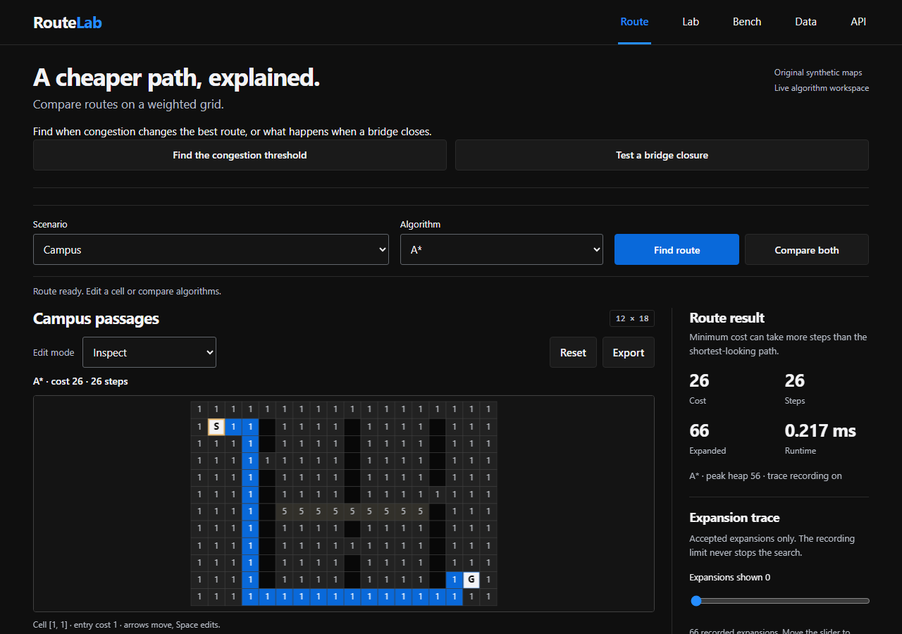

# RouteLab 0.1.1 audit corrections

The JSON importer now checks the map revision, draft revision and import request before applying asynchronous validation. Selecting another map, editing JSON, or editing it away and back cancels the older result. A late failed request cannot replace the status of newer work. A current successful import still applies its exact map.

Two first-screen actions open the existing congestion and bridge-closure experiments. Each action selects its preset and moves keyboard focus to the Lab heading. The editor map remains available. Preset loading has disabled, error and retry states.

## Evidence

- 115 Python tests passed after the version update. The existing result verifier reconciled 45 configurations, 90 summaries and 450 timing rows.
- The importer regression first reproduced the overwrite. Seven real Chromium assertions now cover late success, stale failure, JSON edits, edit-back and ordinary import.
- Ten Chromium assertions cover experiment selection, closure mode, focus, editor preservation, loading failure/retry and widths 304 and 1280 px.
- An independent Code Reviewer executed the import listener with deferred validation and found no blocking issue.
- SHA-256 comparison confirms unchanged bytes for all 59 original result files. This preserves the benchmark and its historical source snapshot.
- An isolated wheel installation passed import, packaged UI, real HTTP route solving and OpenAPI version checks. It uses the existing environment's dependencies.

Records: [browser cases](verification/audit-fixes-browser-2026-10-20.json), [result preservation](verification/audit-fixes-preservation-2026-10-20.json), [installed wheel](verification/installed-wheel-2026-10-20.json).

The screenshot comes from the running local app in Chromium; it contains synthetic map data. We added no decorative image asset. MDN's [input-event contract](https://developer.mozilla.org/en-US/docs/Web/API/Element/input_event) and [Fetch error handling](https://developer.mozilla.org/en-US/docs/Web/API/Fetch_API/Using_Fetch) informed the revision guard and error checks.

## Limits

These changes preserve the routing algorithms and synthetic-grid problem. The checks do not establish geographic navigation quality, multi-cell Lab selection, all browser-engine behavior, screen-reader compatibility or public availability. Earlier browser suites remain historical evidence.
